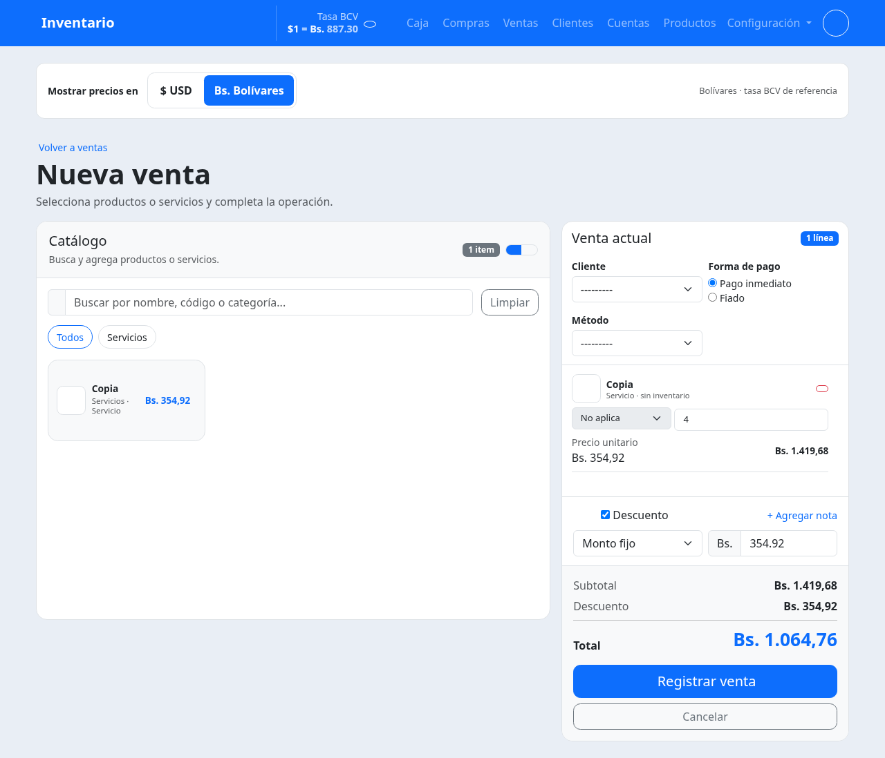
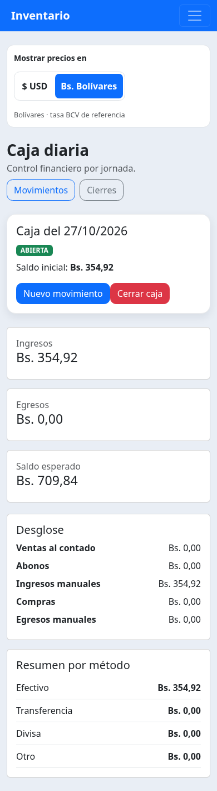

# Selector de moneda

Se muestra un solo importe por precio, saldo o total. El selector «Mostrar precios en»
está sobre el contenido de Productos, Cuentas, Ventas y Caja, visible también en móvil
sin abrir el menú. USD y Bolívares son opciones excluyentes; el estado elegido se
marca con color y `aria-pressed`. Se recuerda la elección en este navegador.

La misma elección afecta catálogo, carrito, subtotales, descuentos, saldos, cierres,
listas cargadas mediante AJAX y campos monetarios. Cantidades, existencias y
porcentajes no son importes y no se convierten. Los campos muestran su unidad.
Los valores contables y los envíos al servidor se conservan en USD, con dos decimales;
al ingresar Bs. se convierte a USD y se redondea a centavos. Los equivalentes usan la
última tasa BCV registrada, no la tasa histórica de cada operación.
Sin tasa positiva se mantiene USD y el control Bs. explica qué falta.

## Referencias consultadas

- [Shopify Polaris: grupos de botones](https://github.com/Shopify/polaris/blob/main/polaris.shopify.com/content/components/actions/button-group.mdx).
  La documentación describe botones segmentados con estado pulsado para alternar
  partes de la interfaz, agrupar acciones relacionadas y cuidar pantallas pequeñas.
  Se consultó el repositorio oficial, actualmente archivado; no se añadió esa biblioteca.
- [Odoo POS: precios y listas de precios](https://github.com/odoo/documentation/blob/20.0/content/applications/sales/point_of_sale/extra/pricing.rst).
  La documentación mantiene una lista activa, una opción predeterminada y permite
  cambiarla desde la caja. Se tomó el principio de un contexto de precios activo y
  coherente, no su configuración de listas ni una supuesta equivalencia de funciones.

Los sitios de Farmatodo y Yummy devolvieron bloqueo del proxy en este entorno. No se
inspeccionaron sus cajas internas. No se verificaron rankings, puntuaciones ni cuotas
de mercado; estas referencias no se presentan como una clasificación de popularidad.

## Prueba local

Actualiza la rama `codex/precios-usd-bs` desde GitHub. Extrae una copia nueva y abre
`PROBAR_EN_WINDOWS.bat`. Prueba el selector arriba de cada módulo, navega entre ellos,
recarga y verifica que conserva la moneda. En ventas cambia cantidades, presentaciones,
descuentos fijos y porcentuales. En Caja verifica apertura, movimientos y cierres.
Cambiar el selector no debe guardar operaciones ni modificar precios del catálogo.

## Capturas de validación

Datos ficticios de prueba, sin operaciones del negocio.

